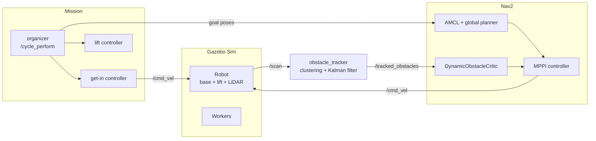

# Warehouse Logistics Robot with Prediction-Aware Navigation Among Workers

<p align="center">
  <strong>ROS 2 Humble · Nav2 (MPPI) · ros2_control · Gazebo Sim (Fortress) · Kalman tracking</strong><br>
  An autonomous shelf-carrying robot that docks under a load, lifts it, delivers it across a
  warehouse and returns — while detecting, tracking and predicting the motion of workers
  walking into its path.
</p>

<p align="center">
  
  
  
  
  
</p>

<p align="center"><i>Tech Project Internship · ITMO University · M.Sc. Robotics and AI · Zyad Alshujaa</i></p>

---

## Demo

<!-- DEMO VIDEO: on GitHub, edit this file and drag your .mp4 onto the empty line below. -->


<p align="center"><i>Full mission with a worker crossing the robot's path (one illustrative run).</i></p>

---

## Contents

1. [The system](#1-the-system)
2. [Architecture](#2-architecture)
3. [Mission cycle](#3-mission-cycle)
4. [Dynamic-obstacle layer](#4-dynamic-obstacle-layer)
5. [Evaluation](#5-evaluation)
6. [Packages](#6-packages)
7. [Build and run](#7-build-and-run)
8. [Status and next steps](#8-status-and-next-steps)
9. [Credits](#9-credits)

---

## 1. The system

A differential-drive logistics robot (0.82 × 0.62 m, 2D LiDAR, lift deck) works in a
simulated warehouse:

```text
navigate to shelf → dock under it → lift → carry to drop bay → lower → return home
```

Warehouses are shared with people. A person crossing the robot's path is a **moving**
obstacle, while Nav2's standard local planners treat every obstacle as standing still at its
current position. The system therefore adds a dynamic-obstacle layer: it **tracks** workers
with the LiDAR, **predicts** where they will be in the next seconds, and lets the local
planner (MPPI) avoid those **predicted** positions during the whole mission.

## 2. Architecture



One robot description, one controller manager, one TF tree and simulated time for all nodes.

## 3. Mission cycle

The mission is a single ROS 2 action, `/cycle_perform` (`logistic_msg/action/MoveRobot`):

| Step | Done by |
|---|---|
| Drive to the shelf approach pose | Nav2 |
| Dock under the shelf, centred with the LiDAR | get-in controller |
| Lift (`/Nema_controller/commands` → 0.154) | ros2_control lift |
| Carry to the drop bay | Nav2 + dynamic-obstacle layer |
| Lower, reverse out, return home | organizer + Nav2 |

Mission poses (map frame): home (−3, 0), shelf approach (−1, 0), drop bay (−5, 13).

## 4. Dynamic-obstacle layer

**Tracking.** LiDAR points on the static map or on the robot itself are removed, the rest
are grouped into objects, and each object is followed by a constant-velocity Kalman filter
(position and velocity). A briefly lost track keeps being predicted for 1.5 s.

**Prediction-aware MPPI critic** (C++ plugin for `nav2_mppi_controller`). MPPI evaluates
2000 candidate trajectories per cycle. For each one the critic places every tracked person
at its predicted position `p + v·t`, and adds:
- a collision cost if the robot footprint would overlap the person,
- a soft cost when closer than a safety margin that grows with prediction time,
- a 3 s terminal extension beyond MPPI's 2.8 s horizon, so that stopping *inside* a
  person's future path is recognised as unsafe.

**Experiment pipeline.** Workers start walking when the robot reaches a trigger point, so
each scenario repeats identically. Every trial runs the full mission in a fresh simulation
and records trajectories, minimum clearance and contacts against ground truth.

## 5. Evaluation

**Tracking and prediction** (measured against ground truth):

| Metric | Result |
|---|---|
| Worker detected when visible to the LiDAR | **99 %** |
| Position error (median) | **12.7 cm** |
| Prediction error at 1 / 2 / 3 s | **0.18 / 0.32 / 0.50 m** (vs 0.55 / 1.13 / 1.72 m without prediction) |

**Navigation** — contacts per trials; worker crossing, head-on or slower ahead; the worker
never yields:

| Scenario | DWB | MPPI | MPPI + critic |
|---|---|---|---|
| Crossing | 5/5 | 10/16 | 10/14 |
| Head-on | 0/5 | 0/5 | 1/5 |
| Overtaking | 4/5 | 1/6 | 0/5 |
| **All** | **9/15** | **11/27** | **11/24** |

Findings:
- MPPI is safer than the default DWB planner (fewer contacts, 0.60 m vs 0.13 m head-on clearance).
- A first critic version made the robot stop inside the worker's path — the known
  *freezing robot problem*; the terminal extension reduced it (head-on 3/5 → 1/5).
- The critic does not yet improve on plain MPPI overall (Fisher p = 0.78); the crossing
  scenario remains the open problem.

108 valid trials in total, including an ablation without prediction; full data and
per-trial results in [`results/`](results/).

## 6. Packages

```text
src/warehouse_dynamic_nav/
├── robot_description/   robot model, meshes
├── robot_bringup/       launch, worlds, map, Nav2 + controller parameters
├── adv_controller/      organizer, get-in controllers, Nav2 client
├── logistic_msg/        MoveRobot action, enable messages
├── dynamic_obstacles/   workers, scenarios, trial runner, batch scripts
├── obstacle_tracker/    LiDAR tracking (Kalman), ground-truth evaluation
├── predictive_nav/      DynamicObstacleCritic (C++), MPPI configurations
└── results/             experiment data
```

| Package | Role | Origin |
|---|---|---|
| `robot_description` | Robot model | base project |
| `robot_bringup` | Simulation, Nav2, controllers | base project, adapted |
| `adv_controller` | Mission executive, docking | base project |
| `logistic_msg` | Interfaces | base project |
| `dynamic_obstacles` | Workers and experiment pipeline | this work |
| `obstacle_tracker` | Person tracking and evaluation | this work |
| `predictive_nav` | Prediction-aware MPPI critic | this work |

## 7. Build and run

```bash
# ROS 2 Humble + ros-humble-nav2-mppi-controller
cd ~/logistic_ws && colcon build --symlink-install && source install/setup.bash

# full mission in simulation (MPPI + critic)
CFG=$(ros2 pkg prefix predictive_nav)/share/predictive_nav/config
ros2 launch robot_bringup igin_sim.xml nav2_config:=$CFG/nav2_mppi_predictive.yaml
ros2 launch obstacle_tracker tracker.launch.py
ros2 launch dynamic_obstacles workers.launch.py scenario:=crossing
ros2 action send_goal /cycle_perform logistic_msg/action/MoveRobot "{action: 'Start'}"

# automatic experiments: method, runs, scenarios
RUN=src/warehouse_dynamic_nav/dynamic_obstacles/scripts/run_trials.sh
TRACKER=1 NAV2_CONFIG=$CFG/nav2_mppi_predictive.yaml bash $RUN mppi_pred2 5
```

## 8. Status and next steps

| Working | Next |
|---|---|
| Full autonomous mission in simulation | Cost on time spent in a person's predicted path, to stop *before* a crossing |
| Worker tracking and prediction from LiDAR | Reactive pedestrian model (e.g. social force) for realistic tests |
| Prediction-aware MPPI critic | Tuning of critic weights on separate runs |
| Repeatable experiment pipeline | Docking from large shelf misalignment |

## 9. Credits

<!-- ZYAD: write this section yourself: the original project, its author, link and
     permission. -->

_To be written._

**References.** Bar-Shalom, Li, Kirubarajan, *Estimation with Applications to Tracking and
Navigation*, Wiley 2001 · Trautman, Krause, "Unfreezing the robot", IROS 2010 · Nav2
`nav2_mppi_controller` (Humble).
